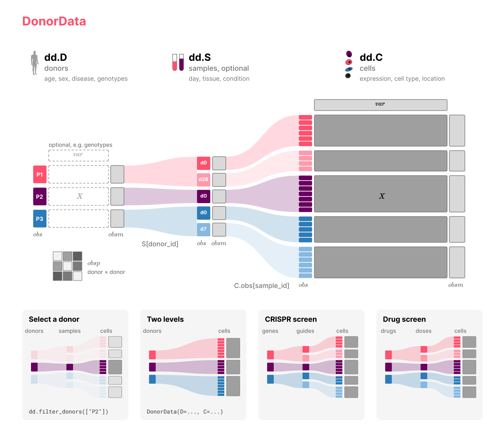

[](https://github.com/theislab/donordata/actions/workflows/build.yaml)
[](https://opensource.org/licenses/Apache-2.0)
[](https://donordata.readthedocs.io/)
[](https://github.com/theislab/donordata/actions/workflows/test.yaml)
[](https://github.com/pre-commit/pre-commit)

# DonorData

[Installation](docs/install.md) | [API](docs/api.md) | [Specification](docs/io/spec.md) | [Design](https://github.com/theislab/donordata/blob/main/DESIGN.md) |
[Changelog](docs/changelog.md)



## Data structure

`DonorData` represents single-cell data together with data on the donors the cells come from, and optionally on the samples in between.

```
DonorData
  .D             donors, one row per donor (a DataFrame of donor labels, or AnnData, MuData, EHRData)
  .S             samples, one row per sample, optional (DataFrame, AnnData or EHRData)
  .C             cells (AnnData or MuData, or the table of cells of a SpatialData)
  .obsm          matrices aligned to the donors, such as embeddings or pseudobulk profiles
  .obsp          donor by donor matrices, such as distances
  .uns           unstructured annotations
  .spatialdata   the SpatialData the cells come from, with the current cells as its table
```

`C.obs[donor_id]` names the donor of every cell. With a sample level, `C.obs[sample_id]` names the sample of every
cell and `S[donor_id]` the donor of every sample. Selecting units at one level selects the matching units at the other
levels, and matrices in `obsm` and `obsp` are subset with them. A donor can be any unit that groups cells, for example
a patient, a target gene in a CRISPR screen or a compound in a drug screen. 

## Overview

### Input

The most common input is an AnnData of cells whose `obs` repeats donor labels, such as disease or age, on every
cell. `from_anndata` moves the columns that are constant within donors into a donor table, so `D` is a DataFrame with
one row per donor and `C.obs` keeps the cell-level columns:

```python
from donordata import DonorData

dd = DonorData.from_anndata(adata, donor_id="patient")
dd.D
```

A donor table can also be passed directly. `D` is an AnnData only when donors have measurements of their own, such as
genotypes:

```python
dd = DonorData(D=patients, C=adata, donor_id="patient")
```

A SpatialData works in the same way: its table of cells becomes `C`, and its images, labels, points and shapes stay
available in `dd.spatialdata`:

```python
dd = DonorData.from_anndata(sdata, donor_id="patient")
```

With several samples per donor, `sample_id` adds the sample table `S`:

```python
dd = DonorData.from_anndata(adata, donor_id="patient", sample_id="sample")
```

### Selection and aggregation

```python
dd = dd.filter_donors("age > 60")
dd = dd.filter_donors_by_cells(20, groupby="cell_type", level="sample")
dd.get_df(["age", "timepoint", "CD14"], level="cell")
dd.composition("cell_type", level="sample")
profiles = dd.pseudobulk(groupby="cell_type", layer="counts", level="sample")
train, test = dd.train_test_split(0.2, stratify="disease")
```

### I/O with `.dd.h5` and `.dd.zarr` files

`DonorData` objects are written to an HDF5 file or a Zarr store with one AnnData or MuData group per level, which
can also be read with anndata alone.

```python
import donordata

dd.write_dd("cohort.dd.zarr")
dd = donordata.io.read_dd("cohort.dd.zarr")
```

## Installation

```console
pip install git+https://github.com/theislab/donordata
```

See the [installation guide](docs/install.md) for optional dependencies.

## Tutorials

The tutorials cover a [first object](docs/tutorials/getting_started.ipynb), a
[patient cohort](docs/tutorials/patient_cohort.ipynb), a [CRISPR screen](docs/tutorials/perturbation_screen.ipynb)
and [electronic health records](docs/tutorials/ehr_cohort.ipynb). [cellink](https://github.com/theislab/cellink)
uses `DonorData` for single-cell genetics and [patpy](https://github.com/lueckenlab/patpy) for sample
representations.

## Citation

If you use DonorData, please cite it as described in [CITATION.cff](https://github.com/theislab/donordata/blob/main/CITATION.cff).
